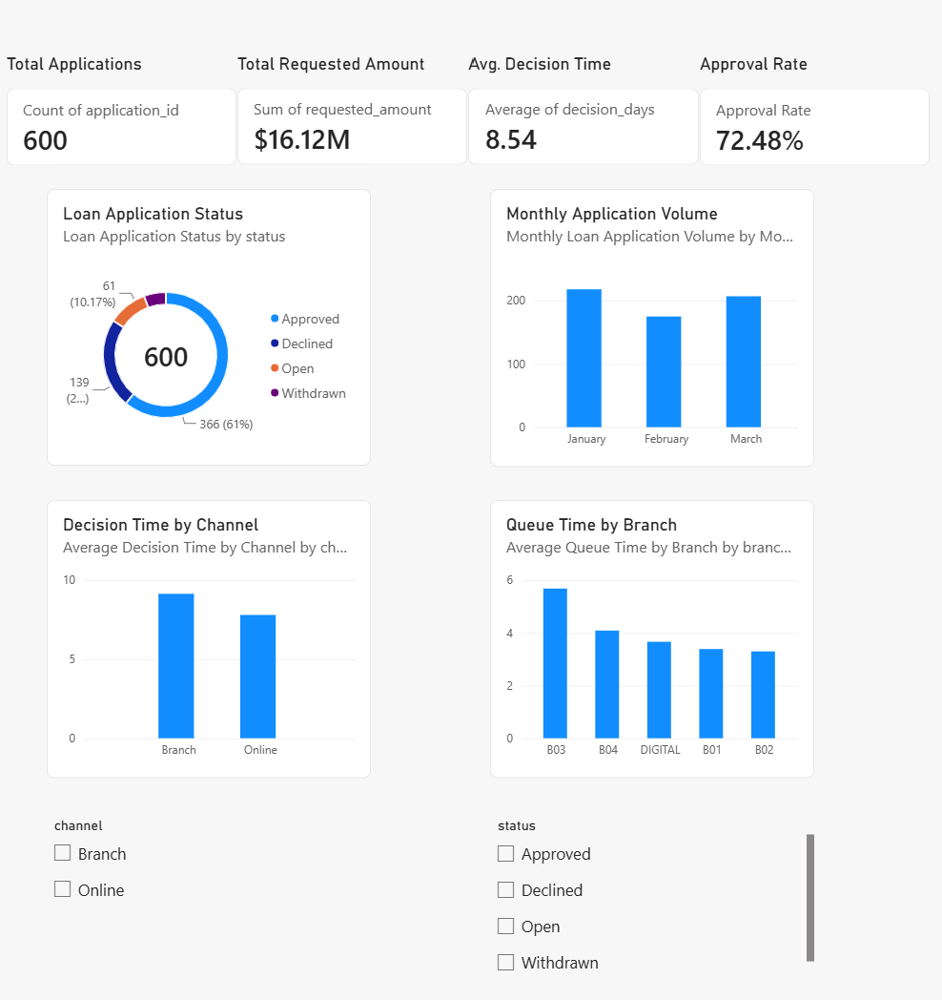
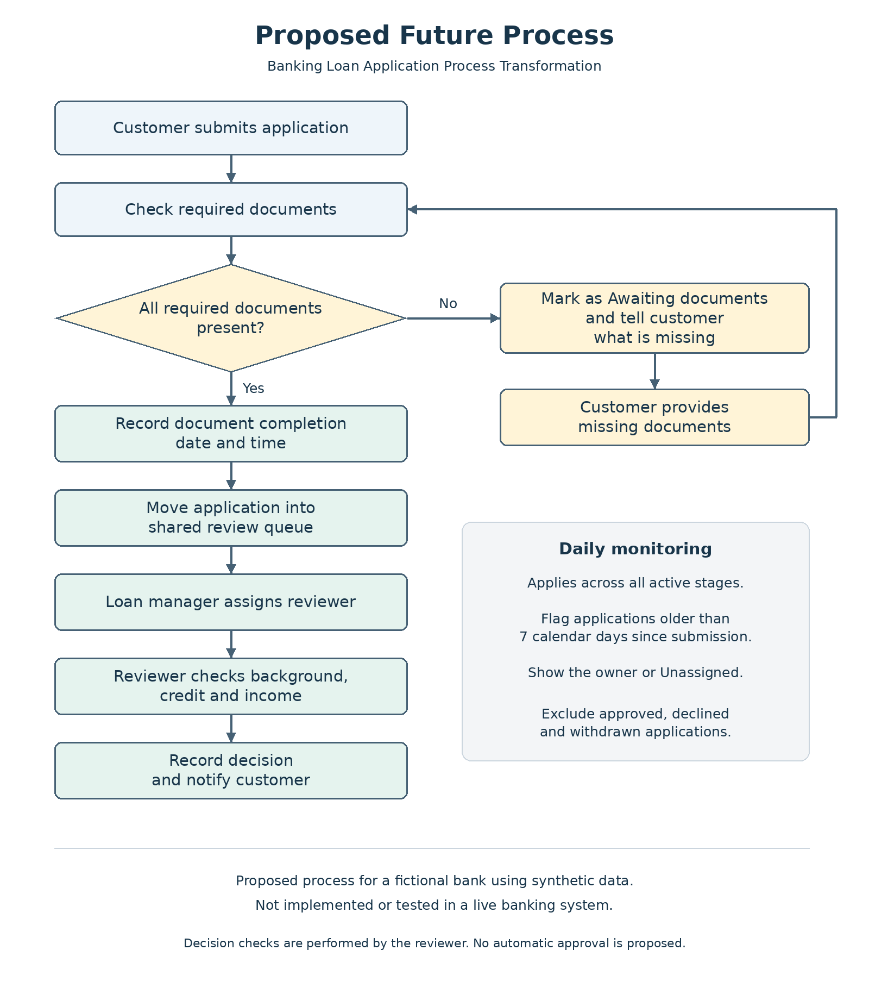

# Banking Loan Portfolio Analytics

### Business Analysis | Data Analysis | Process Improvement | Power BI

An independent portfolio case study exploring how a fictional bank could reduce avoidable delays between personal loan submission and decision while preserving underwriting controls and visibility into unfinished applications.

**Tools used in the guided analysis:** Excel, SQL / SQLite in VS Code, Power BI, process mapping, requirements analysis, and user acceptance test design.

> **Project disclosure:** This is a fictional banking scenario using synthetic data. It is not an employer engagement. Proposed improvements have not been implemented, and no business benefits have been achieved or validated.

## 1. Business Problem

Customers face delays when required documents are missing, while loan officers need complete information and visibility into applications waiting for review.

**Business question:** How could a bank reduce avoidable loan processing delays while maintaining accurate reviews and oversight of open cases?

## 2. Scope and Dataset

The dataset contains **600 fictional unsecured personal loan applications** submitted from January 1 through March 31, 2026. The reporting snapshot is **March 31, 2026**. Durations use calendar days.

The supplied preparation workflow used a deterministic Python generator with seed `20261016`. Its raw export contained 612 rows. The prepared dataset removed 12 exact duplicates and standardized 18 inconsistent channel labels, leaving 600 unique application IDs.

The Python generator and initial database preparation were supplied as learning materials with AI assistance. They are not presented as independently authored Python work.

The **7 calendar day** threshold is a project assumption, not a regulatory deadline or an actual bank service level agreement.

## 3. Power BI Report

The Power BI report presents application volume, requested amounts, approval outcomes, decision times, and branch queue comparisons. This repository includes a static screenshot of the report; the image itself is not interactive.

| Summary metric | Result |
| --- | ---: |
| Loan applications | **600** |
| Total requested amount | **$16.12M** |
| Applications with a decision | **505** |
| Approved | **366** |
| Declined | **139** |
| Open | **61** |
| Withdrawn | **34** |
| Approval rate among decided cases | **72.48%** |
| Average decision time among decided cases | **8.54 days** |

Approval rate is `Approved / (Approved + Declined)`: 366 / 505 = 72.48%. Open and withdrawn applications are excluded from this denominator.

## 4. Process Metrics and Findings

| Metric | Result |
| --- | ---: |
| Average document collection time | 2.61 days |
| Average review queue time | **3.92 days** |
| Average review start to decision time | 2.02 days |
| Average total decision time | **8.54 days** |
| Median decision time | 8.00 days |
| 90th percentile decision time | 14.00 days |
| Decisions completed within 7 calendar days | **43.0%** |
| Missing documents at intake | **34.8%** |
| Open applications older than 7 days at the snapshot | **8 of 61** |

Stage averages and decision times include approved and declined applications only. Open application aging is measured separately at the snapshot date. The 90th percentile uses the nearest rank method. Displayed stage averages are rounded separately, so they may not sum exactly to the rounded total.

### Review queue is the longest stage

The average review queue time of 3.92 days represents the largest stage of elapsed decision time. Queue ownership, routing, and capacity are priorities for investigation. The data do not establish a staffing or system problem as a proven root cause.

### Missing intake documents are associated with longer decisions

Among decided applications, those missing documents at intake averaged **12.20 days**, compared with **6.97 days** for those without missing intake documents. The difference is approximately **5.24 days**, calculated before rounding.

This association is encoded in synthetic data and does not demonstrate a causal effect in a real bank.

### Branch and channel comparisons suggest investigative priorities

Branch applications averaged **9.14 decision days**, compared with **7.80** for online applications. Fictional branch **B03** had the highest average queue time at approximately **5.68 days**.

### Open work needs separate monitoring

The snapshot contains **61 open applications**, including **8 older than 7 days**. Monitoring only completed decisions can hide unfinished cases with long waits.

## 5. Business Analysis Artifacts

The workbook contains the guided project artifacts: gap analysis, requirements and acceptance criteria, a UAT plan, requirements traceability, and a KPI plan.

The proposed changes focus on:

1. A clear intake document checklist and a completeness check before review queue entry.
2. A shared review queue displaying ownership and elapsed queue days.
3. Daily follow up flags for active applications older than 7 calendar days.

The proposed process map shows the document collection loop, queue entry, reviewer assignment, review checks, and decision communication.

An example UAT scenario checks that an active application aged 8 days is flagged, one aged exactly 7 days is not flagged, and approved, declined, and withdrawn applications are excluded from active follow up.

**UAT status:** Test scenarios were designed but not executed against an implemented system. SQL data checks are separate from system UAT. Requirements and process changes have not received actual stakeholder approval.

## 6. Proposed Pilot and KPI Plan

The latest proposal is a **4 week pilot** of the document checklist, shared review queue, and daily follow up flags.

| KPI | Synthetic baseline | Proposed target | Measurement |
| --- | ---: | ---: | --- |
| Average decision time | 8.54 days | **7.00 days or less** | Average submission to decision days for approved and declined applications |
| Average review queue time | 3.92 days | **3.00 days or less** | Average document completion to review start days for approved and declined applications |
| Missing documents at intake | 34.8% | **25.0% or less** | Applications missing documents at initial submission divided by all submitted applications |
| Decisions within 7 days | 43.0% | **60.0% or more** | Approved and declined applications decided within 7 days divided by all approved and declined applications |

These are illustrative planning targets for stakeholder discussion. They have not been approved, tested, or achieved. This latest plan supersedes earlier draft assumptions of an 8 week pilot and a 7.26 day average decision target.

Use comparable cohorts and consistent definitions when evaluating a pilot. Consider channel mix, application complexity, staffing, and seasonality. Continue tracking open applications and their age, and allow follow up beyond the pilot window for unresolved cases. A concurrent comparison group would strengthen the evaluation.

Faster decisions should not come at the expense of underwriting controls or increased backlog, complaints, or audit exceptions. No operational pilot was conducted for this portfolio.

## 7. My Contribution and AI Assistance

I completed this as a guided learning project with ChatGPT assistance.

1. **Excel:** Worked through application duration calculations, summary analysis, duplicate removal, and business analysis worksheets.
2. **SQL:** Entered and ran the queries in `03_practice.sql` using SQLite in VS Code. These check raw and clean row counts, duplicate IDs, unique applications, channel volumes, stage averages, branch queues, decisions within the target, open application aging, and missing document comparisons.
3. **Business analysis:** Worked through the problem definition, proposed changes, requirements, acceptance criteria, traceability, UAT scenarios, and KPI targets.
4. **Power BI:** Built and reviewed the report using the prepared application data.

AI assistance included synthetic data generation, initial workbook and database preparation, example queries, explanations, troubleshooting, documentation drafts, and process map creation. The uploaded SQL demonstrates the queries completed during guided practice; it is not a claim of independently designing the entire data preparation pipeline.

## 8. Repository Files

| File | Purpose |
| --- | --- |
| [Excel analysis workbook](Loan_Process_Analysis.xlsx) | Application data, calculations, and business analysis worksheets |
| [Case study document](Banking_Loan_Case_Study.docx) | Supporting narrative and proposed transformation analysis |
| [SQL analysis queries](03_practice.sql) | Validation checks and analytical queries completed in guided practice |
| [SQLite database](loan_analysis.sqlite) | Prepared data and metrics used by the SQL queries |
| [Power BI report screenshot](Banking_Loan_Dashboard.png) | Static preview of the Power BI report |
| [Proposed future process map](Proposed_Future_Process.png) | Document completeness, review queue, review, and monitoring design |

### Run the SQL

Download `loan_analysis.sqlite` and `03_practice.sql`. Open the database in a SQLite client, then execute the SQL file against it. The queries read the existing `raw_applications`, `applications`, and `application_metrics` objects.

Expected checks include 612 raw rows, 600 clean rows, 600 distinct application IDs, and 505 completed decisions. The queries are read only and do not rebuild the database.

The repository includes the prepared database, rather than the Python generator or a full database rebuild pipeline. It also contains a Power BI screenshot rather than an editable Power BI report file.

## 9. Limitations

The data are fictional. The generator intentionally encodes longer document delays for incomplete intake and additional queue waiting for one branch. Approval and decline outcomes were randomly assigned and do not represent a credit risk model.

The dataset does not measure staff labor, customer experience, underwriting complexity, business day timing, or real institutional outcomes. Findings demonstrate analytical methods and prioritization rather than industry benchmarks or proof of causation.

No cost savings, time savings, or operational improvement has been achieved or validated. Proposed UAT scenarios remain unrun.

## 10. Project Takeaway

This case study connects Excel and SQL analysis with Power BI reporting, process evaluation, requirements, test design, and proposed success measures. It demonstrates how to explain a business problem, calculate consistent metrics, identify areas for investigation, and define changes that could be evaluated in a future pilot.

